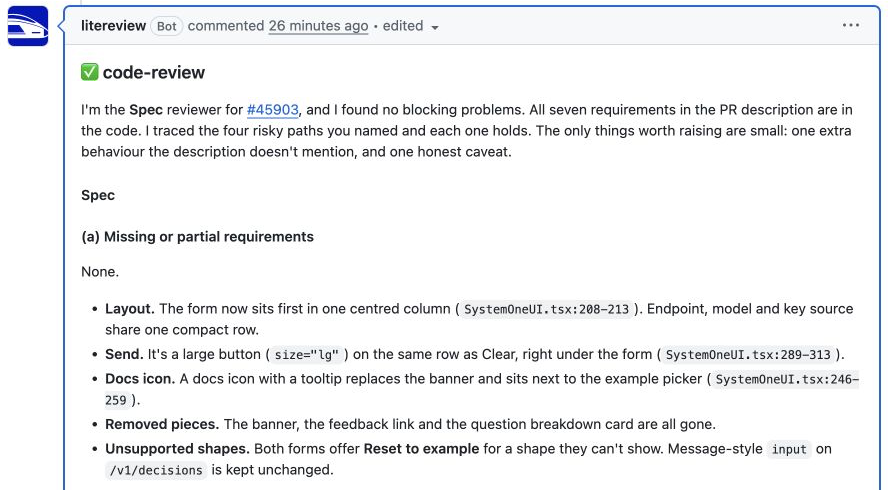

<p></p>

# LiteReview

**Code review agents for your GitHub pull requests.** Choose a model, tell it what to check, and get findings posted back to the PR. Reviewers can read code, run tests, and check your app in a browser. You host the workspace and control its model connections, instructions, skills, and tools.

Once your workspace is connected, request a review with a new PR comment:

```text
@litereview
```

LiteReview runs the default reviewer in an isolated sandbox and posts its report, checks, and links to findings. It never pushes fixes.

[Get started](#get-started) · [Deployment guide](docs/DEPLOYMENT.md) · [Reviewer guide](docs/REVIEWERS.md) · [Contributing](CONTRIBUTING.md)

## Get started

Choose the path that matches where you are:

| Your starting point | Next step |
| --- | --- |
| You need a workspace for your team | **[Deploy to Render](docs/DEPLOYMENT.md)** — the complete path from accounts to a review on your PR. |
| Your team already has a workspace | **[Start a review](#start-a-review)** — sign in, link GitHub, and post a comment. |
| You want to explore or change the UI and API locally | **[Local development](#local-development)** — no cloud credentials needed to open the workspace. |

### Deploy to Render

The included [Render Blueprint](render.yaml) provisions the web service and Postgres. You need:

- A **Render account** for hosting and a **Modal account** for review sandboxes.
- A **Google Workspace organization** for team sign-in.
- An **OpenAI API key** or a **Responses-compatible model gateway**. Anthropic models require a compatible gateway.
- Permission to **create and install a GitHub App** for your repositories. Organization repositories may require an owner's help.

**[Create your workspace →](docs/DEPLOYMENT.md)** The guide walks through credentials, deployment, GitHub connection, and a first reviewer. GitHub App credentials are created by the guided setup; model keys are added in the UI. You do not need a separate Modal app deployment or Lens installation.

Render hosting, Modal sandboxes, and model calls incur charges. This beta supports one trusted team per deployment: every admitted member can manage shared configuration and connections. Spend visibility and admin-role changes are restricted to admins. Read the [security boundary](SECURITY.md#intended-deployment-boundary) before connecting private repositories or shared tools.

## Start a review

You need your team's LiteReview URL, access to a connected GitHub repository, and a reviewer that has passed its check. If the workspace is new, complete the [deployment guide](docs/DEPLOYMENT.md#get-your-first-review) first.

1. Open your team's LiteReview URL and choose **Sign in with Google**. Choose **Connect GitHub** and link the account you use to comment on PRs. Each teammate does this once.
2. Open **Start a review** from **Repositories**. Select your repository and reviewer if prompted, then choose **Copy comment**. This page checks your GitHub access and shows the command you can use.
3. Paste the command as a **new comment on an open PR** in that repository. For the workspace's default reviewer:

   ```text
   @litereview
   ```

To choose a saved reviewer, include its name: `@litereview code-review review this pls`. LiteReview matches exact agent and group names in the mention's paragraph and ignores extra wording and separate generated footers. The reviewer uses its saved instructions.

**Check the result:** LiteReview adds 👀 to an accepted request and keeps one summary comment per reviewer and PR. Reruns edit that same comment in place. When the review finishes, it contains the latest report and links to findings on the diff. Open **View review** or **Runs** for the reviewed commit, checks, screenshots, and activity. The first run can take several minutes while Modal builds the sandbox image.

A ✅ means the review completed; read its findings and checks. A ⚠️ and **Review incomplete** identify work that could not finish. A completed review can still report bugs or checks that were not run.



*Excerpt from an actual [review on a public LiteLLM PR](https://github.com/BerriAI/litellm/pull/45903#issuecomment-6105980973) by a reviewer configured to check the PR specification.*

If nothing starts, use the [trigger troubleshooting steps](docs/DEPLOYMENT.md#troubleshoot). If your team is already connected, you do not need to create another GitHub App or model connection.

## Configure reviewers

Start with one reviewer and its default instructions. Add more when you have a task for them:

- **Choose the task:** edit **PR agents → reviewer → Review instructions**, or use the [independent bug-review example](examples/reviewers/independent-bugs.md).
- **Choose the tools:** enable browser or computer use, attach skills, or select tools from a connected [MCP server](docs/REVIEWERS.md#connect-mcp-tools). Terminal access is included.
- **Run several reviewers:** give agents or groups distinct names, then comment `@litereview frontend security` after creating those names. Each reviewer posts its own result.
- **Combine models:** use [Fusion](docs/REVIEWERS.md#combine-independent-reviews-with-fusion) to combine independent model reviews into one final report.
- **Review automatically:** add [repository rules](docs/GITHUB.md#run-reviews-automatically) for PRs opening, becoming ready, receiving commits, reopening, or getting a label.

The first reviewer becomes the default automatically. Use **PR agents → Set default** to change it. Run **Test agent** after changing its model or tools; the check uses a sample project and consumes Modal/model credits.

Review time and model-call limits are optional. Configure them in the agent editor and set budgets with your providers. Admins can [track recorded model spend](docs/OPERATIONS.md#track-review-spend); it excludes Modal and hosting charges.

## Local development

This path opens the UI and API with SQLite and a local access key. Running a real PR review still requires Modal, a model connection, a GitHub App, and a public HTTPS URL that Modal can reach. There is no local review sandbox backend.

Install [Python 3.12](https://www.python.org/downloads/), [Node 22](https://nodejs.org/), and [uv 0.10.9](https://docs.astral.sh/uv/getting-started/installation/). In a macOS or Linux shell:

```sh
git clone https://github.com/BerriAI/litereview.git
cd litereview
uv sync --frozen --python 3.12
npm ci --prefix frontend
npm run build --prefix frontend
```

Create the local configuration. This generates separate encryption and sign-in keys and refuses to overwrite an existing `.env`:

```sh
uv run python - <<'PY'
from pathlib import Path
import secrets

text = Path('.env.example').read_text()
for name in ('SECRET_KEY', 'ADMIN_TOKEN'):
    text = text.replace(f'{name}=\n', f'{name}={secrets.token_urlsafe(32)}\n')
with Path('.env').open('x') as output:
    output.write(text)
Path('.env').chmod(0o600)
PY
uv run uvicorn app.main:app --host 127.0.0.1 --port 8000 --no-access-log
```

Open [localhost:8000](http://localhost:8000). Enter the generated `ADMIN_TOKEN` value from `.env` in **Workspace access key** to see the workspace. No Google, GitHub, Modal, or model credentials are needed for this local UI/API trial.

Continue with the [development guide](docs/DEVELOPMENT.md) for hot reload, Docker Compose, tests, and live review testing. Stop the server with **Ctrl+C**; your local configuration and SQLite data remain for the next start.

## Documentation

<!-- Preserve destinations for existing links into the former long README. -->
<a id="resume-github-setup"></a>
<a id="google-workspace-sso"></a>
<a id="existing-github-app"></a>
<a id="capabilities"></a>
<a id="codex-runtime"></a>
<a id="combine-independent-reviews-with-fusion"></a>
<a id="existing-reviewers"></a>
<a id="connect-mcp-tools"></a>
<a id="run-reviews-automatically"></a>
<a id="track-review-spend"></a>
<a id="runtime-and-boundaries"></a>
<a id="optional-tracing-with-lens"></a>
<a id="review-execution"></a>

| Task | Guide |
| --- | --- |
| Deploy, configure spend admins, back up, or update | [Deployment](docs/DEPLOYMENT.md) |
| Configure models, instructions, Fusion, skills, or MCP tools | [Reviewers](docs/REVIEWERS.md) |
| Manage LiteReview from Claude or another MCP client | [Connect an AI assistant](docs/MCP.md) |
| Connect an existing GitHub App, resume setup, manage SSO, or add automatic reviews | [GitHub and access](docs/GITHUB.md) |
| Read costs, export traces to Lens, or understand execution limits | [Operations](docs/OPERATIONS.md) |
| Run locally, contribute, or check integration evidence | [Development](docs/DEVELOPMENT.md) · [Contributing](CONTRIBUTING.md) · [Validation](docs/VALIDATION.md) |

[MIT license](LICENSE) · [Security](SECURITY.md) · [Third-party notices](THIRD_PARTY_NOTICES.md) · [Report an issue](https://github.com/BerriAI/litereview/issues)
