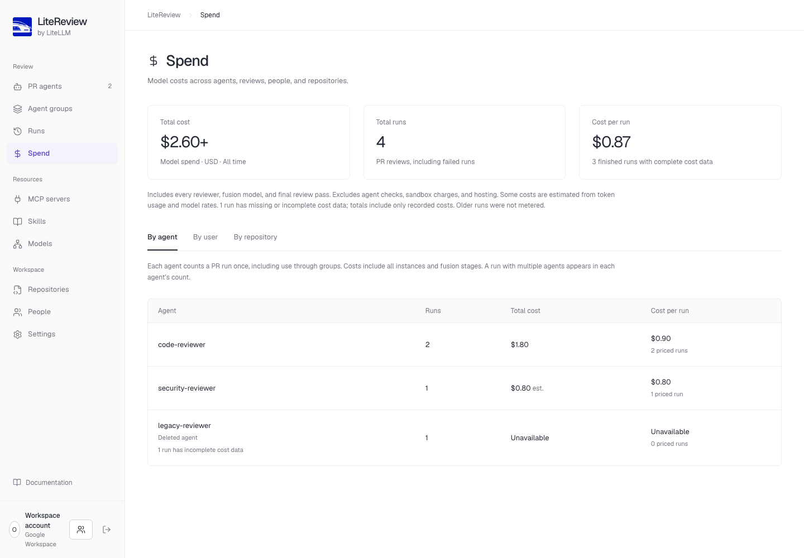

# Operate LiteReview

For deployment, backups, and updates, start with [Operate and update](DEPLOYMENT.md#operate-and-update).

- [Track review spend](#track-review-spend)
- [Optional tracing with Lens](#optional-tracing-with-lens)
- [Review execution and limits](#review-execution)
- [Reuse repository dependencies](#reuse-repository-dependencies)

## Track review spend

Admins can open **Spend** for all-time model cost, PR run count, and average cost per run. Use **By agent**, **By user**, or **By repository** for the same breakdown. Each agent counts a PR run once, including use through groups; its cost includes all instances, fusion branches, and the final review pass. Runs with multiple agents count toward each agent, while the workspace total counts the run once. Renamed agents keep their history and deleted agents retain their recorded spend. Admins also see each review’s model cost in **Runs**, including every fusion branch and the final review pass. Other members see no costs; the API enforces the same restriction. Grant additional admin roles in **People → Make admin** after [configuring the first admin](DEPLOYMENT.md#spend-admins).

Costs use the gateway’s reported amount when available. Otherwise, LiteReview estimates from token usage, cached tokens, and available model rates; these amounts are labeled **est.** Unknown costs appear as **Unavailable**, and a **+** marks a partial total. Older runs have no recorded costs. Average cost includes only finished runs with complete cost data. Agent checks, Modal charges, and hosting are excluded. These totals are usage tracking, not an invoice or spending limit.



Example workspace with local test data.

## Optional tracing with Lens

LiteReview can send review traces to [Lens](https://github.com/BerriAI/lens) or an OTLP/HTTP collector.
Tracing is off by default. You can run LiteReview without Lens or any Berri-hosted service.

1. Deploy Lens and sign in. Open **Tracing key** and generate a key for LiteReview.
2. Set these variables in the LiteReview API environment, then restart or redeploy it:

   ```dotenv
   LITEREVIEW_TRACE_ENDPOINT=https://YOUR-LENS-HOST/v1/traces
   LITEREVIEW_TRACE_API_KEY=YOUR-LENS-TRACING-KEY
   LITEREVIEW_TRACE_CONTENT=false
   ```

   Use the full OTLP/HTTP endpoint, including `/v1/traces`. The API server must be able to reach it.
   Use a tracing key, not the Lens admin token. For a collector without authentication, leave the key empty.
3. Run a review or use **Test agent** in the agent editor. In Lens, open **Traces** for that reviewer.
   Each agent's review appears as one run. Open it and select **Thread** to read its messages,
   tool calls, tool results, and final review when content capture is enabled. **Steps** shows
   the individual model calls under the review. Agents in a group have separate runs.

Traces include the reviewer, harness, model, job and run IDs, duration, status, and token counts when the
provider supplies them. To capture the conversation, set `LITEREVIEW_TRACE_CONTENT=true`.
This exports full prompts, responses, tool arguments, tool results sent back to the model, and the
submitted review. It can include private source code and command output. Images, encrypted reasoning,
request headers, and stored credentials are not captured. Secrets inside conversation text or tool
arguments and results are not redacted.

Codex model requests export through the API. The collector key never enters a Modal sandbox.
Exports run in the background without a queue-size cap. Failed exports are logged; reviews continue.
An API restart can lose pending exports; later calls still join the same review. The parent span and
final review appear when the run finishes. Unfinished required checks mark the review incomplete.
Previously recorded traces keep their original structure; content omitted from old exports cannot be recovered.

If traces do not appear, check the endpoint and tracing key, then check the API logs for export errors.
Keep `/v1/traces` in the endpoint. To turn tracing off, clear `LITEREVIEW_TRACE_ENDPOINT` and redeploy.

## Review execution

The FastAPI service serves the built React UI and runs a durable Postgres-backed dispatcher. Each job runs Codex in a separate Modal sandbox with Python 3.12, Node 22, Chromium, Playwright, and a Linux desktop. LLM inference happens at the configured provider.

The checkout is a GitHub source archive at the PR's immutable head SHA, rather than a full Git clone. It does not include `.git` history, materialize submodules or Git LFS objects, or preserve symlinks. Repositories that depend on those features need additional support. Executable reviews use the repository's configured setup command, start command, and readiness URL; external services, private package registries, and test accounts still need their own configuration. Modal sandboxes have outbound internet access by default, including package installation and browser navigation. This does not grant access to private networks or credentials.

Long-lived model and MCP keys are encrypted in the database using `SECRET_KEY`. They stay in the API service. Sandboxes use job-scoped tokens to call the configured model/MCP relay. Tokens remain valid only while the job is active; an explicitly selected timeout also expires access after a short result-reporting grace period. GitHub credentials never enter the checkout. Optional repository test secrets are deliberately made available to the sandbox; use test credentials only.

Repository downloads and extraction have no LiteReview size or file-count limit. Downloads stream through the API into a temporary file in the sandbox, and extraction copies file contents in chunks. Available sandbox disk space and upstream service limits still apply. LiteReview also accepts PRs without a changed-file or diff-size cap; the full diff is stored and available to review tools, with optional ranges chosen by the agent.

Screenshots and activity logs are private Postgres records with no LiteReview size or count cap. Skill uploads, instructions, tool results, review findings, and summaries are also retained without application size caps or truncation.

File, search, shell, browser, and MCP tools return their full results unless the agent requests a range. Model, MCP, download, setup, and tool requests have no LiteReview deadline unless one is explicitly selected for the run or command. Codex, models, and upstream services still enforce their own context capacities.

Sandboxes launch on demand across reviews by default. Set `CONCURRENCY` to a positive number for an optional workspace-wide cap; `0` leaves concurrency to Modal account quotas and provider rate limits. Each sandbox requests 2 CPU cores and 4 GiB of memory. Time and model-call budgets are optional per-agent settings. Legacy `JOB_TIMEOUT`, `MAX_ROUNDS`, and `MAX_REVIEW_MINUTES` environment values no longer impose defaults. Existing reviewers have no minimum by default. Keep Postgres backups enabled; deleting the database loses settings and run history.

GitHub webhooks are the entry point for comments, review-thread replies, and automatic review rules. LiteReview does not poll GitHub for missed comments. If an event is missed, inspect the GitHub App's recent webhook deliveries and redeliver it after fixing delivery, or post a new request. Stable comment IDs prevent a redelivery from starting duplicate work. Existing comment-sweep settings are no longer used.

Review sessions serialize work for each repository, PR, and agent. Repeated requests link to active work; one pending review retains the latest requested commit. Thread follow-ups use the same queue. Session state, baselines, and finding decisions persist in Postgres. See [review sessions and reruns](REVIEWERS.md#review-sessions-and-reruns) for incremental reviews and private full-review comparisons.

Pending jobs survive API restarts; completed jobs are never rerun automatically. Sandboxes are terminated on completion. The dispatcher reattaches to recorded active sandboxes after API restarts and reports an incomplete result if a sandbox exits without a result. Modal’s 24-hour lifetime still applies. Publication retries recover each agent’s marked comments and finding threads after a lost response. A shared lock allows only one publisher per run during deployment overlap. Existing aggregate progress comments link to the agent results when their runs finish; already published runs remain unchanged. Results always name the reviewed SHA; later pushes are called out.

Reviews longer than GitHub's 65,536-character comment limit are published across multiple comments without truncating the review. Retries recover every already-published part. Each agent comment links to its inline finding threads where a usable diff line exists. Finding-thread replies can trigger a focused assessment and resolution; the stored review session survives sandbox shutdown. It has no automatic fixes, local stdio MCP servers, or plugin marketplace. For supported push triggers, see [automatic reviews](GITHUB.md#run-reviews-automatically); for combining models, see [Fusion](REVIEWERS.md#combine-independent-reviews-with-fusion). See [SPEC.md](../SPEC.md) for the product decisions and [VALIDATION.md](VALIDATION.md) for actual test evidence and external setup boundaries.

## Reuse repository dependencies

Save the dependency installation command in the repository's **Setup command**. LiteReview automatically prepares a reusable Modal filesystem snapshot from the repository's default branch, without model, GitHub, MCP, job, or repository test credentials. An empty setup command leaves warming disabled: dependency commands chosen later by the review agent cannot be preinstalled.

For LiteLLM reviews that need its proxy development dependencies, use:

```sh
uv sync --frozen --group proxy-dev --extra proxy
```

Use an idempotent setup command that reconciles installed packages against the current revision's lockfile. Each review restores a compatible snapshot when available, downloads the exact accepted PR head SHA, replaces the baseline source, injects its test secrets, and runs setup again. The snapshot preserves top-level `.venv` and `node_modules` directories and package-manager caches outside the checkout. Other generated checkout files and nested dependency directories are removed. A PR that supplies its own `.venv` or `node_modules` directory takes precedence over the cached directory. Reviews never write back to the shared snapshot.

An unchanged `uv sync --frozen` can reuse installed packages. LiteReview preserves build-input timestamps only when the extracted file's SHA-256 matches the trusted baseline, so unchanged local package metadata does not trigger unnecessary rebuilds. Changed dependencies are reconciled by the package manager; this can include removals, upgrades, rebuilds, and downloads. `npm ci` removes and reinstalls `node_modules`, although its download cache can still help. Snapshot reuse does not promise that only newly added packages will download or that total review time will halve.

Warming runs separately from reviews, one repository at a time per API process. It refreshes daily, retains snapshots for seven days, and retries failed builds after an hour. A build has a 45-minute maintenance deadline. Repository identity, GitHub installation, setup command, runner code, runtime dependencies, or harness changes invalidate compatibility. Test secrets are never used to build snapshots, so setups that require them may remain cold. A compatible previous snapshot remains usable while a refresh runs or fails. Missing, expired, incompatible, or unrestorable images fall back to a fresh sandbox without waiting for a build.

**Verify reuse:** open a run's activity and look for **Restored repository dependency snapshot**, followed by **Repository setup completed in …s**. Cold launches and restore failures are also recorded. Read the repository through MCP or `GET /api/repositories/{repository_id}/snapshot` while signed in for the current state, default-branch source SHA, expiry, and last refresh error. Compare setup and total review time separately; the first build and daily refresh incur additional Modal compute and storage charges.
